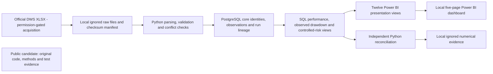

# Investment Fund Analytics

A local investment-fund analytics portfolio project for analytics, data science, AI/data-platform and financial-data engineering roles. It demonstrates Python/pandas data preparation, PostgreSQL/SQL modeling, validation and Power BI reporting using two Luxembourg-domiciled UCITS share classes. The delivered system is a local analytical workflow; it contains no predictive ML or production deployment.

## Delivered scope

The pipeline ingests and validates official DWS/Xtrackers XLSX histories, preserves acquisition checksums and original run lineage, loads PostgreSQL idempotently, and produces reconciled performance, observed drawdown and controlled-risk analytics. The delivered sample contains two EUR accumulating Luxembourg-domiciled UCITS share classes, not a representative fund-industry universe:

| Fund | ISIN |
| --- | --- |
| Xtrackers Euro Stoxx 50 UCITS ETF 1C | LU0380865021 |
| Xtrackers II Eurozone Government Bond UCITS ETF 1C | LU0290355717 |

Validated outputs include cumulative NAV change, CAGR, monthly/calendar-year returns, observed maximum drawdown and recovery, annualized volatility, zero-target downside deviation, historical 95% VaR/expected shortfall and rolling 63/252-observation volatility. SQL and Python results were independently reconciled. The 16 October 2026 repository audit recorded **66 passed, 0 failed, 0 skipped** tests in the configured local environment. Subsequent Batch 2 isolation checks on the same date recorded **67 passed, 0 failed, 0 skipped**, including one new database-name guard regression; working core tables and sequences remained unchanged. See [testing evidence](docs/testing_validation.md). These are dated results, not a permanent result or a fresh-clone guarantee.

The user completed and manually reviewed all five Power BI pages: Executive Overview; Performance Comparison; Risk & Drawdowns; Fund Detail; Data Quality & Methodology. Twelve PostgreSQL presentation views feed the documented star-schema model. The PBIX is local and Git-ignored. Codex independently checked SQL results and repository DAX definitions; it did not inspect PBIX contents, execute its DAX, or independently verify Desktop interactions. See [dashboard evidence and boundaries](reports/powerbi_validation.md).

## Architecture and demonstrated skills

The diagram describes the implemented architecture; it is not a published data feed. Local raw files, numerical evidence and the imported-data PBIX stay outside the public candidate. Data access depends on provider availability and permission, while public release depends on the separate rights review.

| Capability | Evidence in this project |
| --- | --- |
| Data engineering | Source checksums, original ingestion lineage, PostgreSQL keys/constraints and idempotent conflict-safe loading |
| Analytics and data science | Defined return/risk conventions, independently reconciled SQL/Python outputs and deterministic calculation tests |
| BI communication | Five user-completed pages with explicit windows, quality caveats and guarded measure contexts |
| AI/data-platform foundations | Input validation, reproducibility, evaluation discipline and traceability; no AI/ML model is represented as delivered |

| Completed dashboard page | Non-numerical purpose |
| --- | --- |
| Executive Overview | Separate fixed-window performance and controlled-risk summaries |
| Performance Comparison | Rebased/cumulative NAV paths and monthly/year reporting |
| Risk & Drawdowns | Observed loss/recovery paths and eligible-window rolling risk |
| Fund Detail | Share-class identity, methodology and individual metrics |
| Data Quality & Methodology | Coverage, calendar classifications, limitations and original source lineage |

## Methodology boundaries

- Performance uses the chosen 2021-09-30 to 2026-09-30 window; controlled risk uses 2023-12-01 to 2026-09-30. Detailed observed coverage/count findings remain local pending permission.
- Consecutive observed NAVs retain actual elapsed days. Ordinary weekends and reviewed issuer closures are retained; intervals spanning unapproved omissions are excluded. No NAV forward-filling or manufactured zero returns occurs.
- Volatility/downside annualization uses approximately 252 valuation intervals/year. Downside deviation targets zero return. VaR/ES describe variable-calendar-length valuation intervals, not uniform one-calendar-day losses.
- Drawdowns follow observed NAVs and may miss unobserved losses or earlier recovery. Native NAV is not independently certified corporate-action-adjusted total-return data.
- Sharpe, Sortino, correlation, beta, tracking error, information ratio and benchmark-relative claims remain disabled. Cash integration and benchmark date/basis verification remain incomplete. No ML is implemented.

See [metric definitions](docs/metric_definitions.md), [calendar review](reports/calendar_completeness.md), [risk methodology](docs/risk_methodology.md) and [cash/benchmark limitations](docs/cash_benchmark_validation.md).

## Reproduce locally on Windows

Start with [environment and configuration](docs/environment_setup.md), then follow the complete [clean-clone workflow](docs/reproduction_guide.md). It covers permission-gated acquisition, selecting the new acquisition manifest, bootstrap, loading, analytical SQL, presentation views and Desktop refresh. A normal CPU laptop is sufficient; no GPU, HPC, Docker or cloud account is required.

Private configuration roles: `.env` administrator; `.env.owner` schema owner; `.env.app` application/Power BI. The tracked `.env.example` contains placeholders only. Raw/processed datasets, credentials, virtual environments and PBIX artifacts remain excluded from Git. A fresh clone must obtain permitted inputs and local credentials; it cannot assume the developer's ignored manifest or six earlier sample workbooks exist.

## Repository guide

| Location | Purpose |
| --- | --- |
| src/investment_fund_analytics/ | Ingestion, validation, loading and analytics/reconciliation modules |
| sql/ | Core/benchmark schemas, analytical and twelve Power BI presentation views |
| tests/ | Deterministic calculation/parser checks and local integration checks |
| docs/ | Sources, data dictionary, methodology, environment and Power BI build guidance |
| powerbi/measures.dax | Approved SQL-result selection and display-context measures |
| reports/ | Existing dated validation evidence; not blanket publication permission |
| data/raw/, data/interim/, data/processed/ | Local ignored inputs and generated outputs; tracked placeholders only |
| notebooks/, reports/figures/ | Reserved explanatory work/figure locations |

Power BI references: [data model](docs/powerbi_data_model.md), [field mapping](docs/powerbi_field_mapping.md), [build/refresh guide](docs/powerbi_build_guide.md). Numerical report generators now write local ignored reports; they do not overwrite the manually maintained dashboard evidence record.

## Data rights and release status

DWS source-use/publication permission remains unresolved and redistribution is restricted. Public download access and project approval do not confer provider permission. Keep original workbooks, processed series, database exports and the imported-data PBIX local. Derived numbers, charts, screenshots and PDFs are **not automatically cleared for publication**. The [publication inventory](docs/publication_review.md) and [redaction comparison](docs/publication_redactions.md) record targeted withholding of actual financial results, recovery-event details, benchmark comparisons and diagnostic rate samples from this working-tree candidate. Exact originals are preserved in a checksum-verified ignored local archive. Detailed observed calendar records and empirical coverage/count summaries are withheld locally pending permission. Ordinary fund identities, chosen analysis parameters and project-generated provenance remain public. See [source register](docs/source_register.md) and [benchmark sources](docs/benchmark_sources.md).

The dashboard is completed according to the user's manual review; this is a methods-focused publication candidate, not a legally cleared release. Successful private numerical validation is documented without publishing its withheld values; publicly repeatable financial validation still requires permitted inputs and a local setup. The previously pushed initial commit also contains numerical content: sanitizing a later tree would not erase public Git history. No history rewrite or removal has been performed. Public artifact release remains conditional on rights and content checks. This documentation update neither publishes data-bearing artifacts nor clears their rights. The project is descriptive and educational, not investment advice or a regulatory risk assessment.
