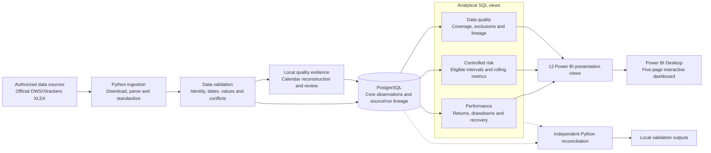

# Investment Fund Analytics

Investment Fund Analytics transforms historical fund net asset values (NAVs) into validated performance, risk and interactive business intelligence outputs. Python handles acquisition, parsing and quality checks; PostgreSQL preserves observations and source lineage; analytical SQL and independent Python calculations reconcile the results used by a five-page Power BI dashboard.

The system runs locally on a Windows laptop, using CPU-based processing and a local PostgreSQL instance. It analyzes two EUR accumulating, Luxembourg-domiciled UCITS share classes:

| Fund | ISIN |
| --- | --- |
| Xtrackers Euro Stoxx 50 UCITS ETF 1C | LU0380865021 |
| Xtrackers II Eurozone Government Bond UCITS ETF 1C | LU0290355717 |

## Key capabilities

- **Data ingestion and cleaning:** date-bounded official XLSX downloads, checksum manifests, workbook parsing and standardized observations.
- **Data quality:** identity, currency, date, positivity, duplicate, overlap and conflict checks; suspicious changes remain flagged for review.
- **Relational storage:** constrained PostgreSQL tables, acquisition/run lineage and transactional, idempotent observation loading. Conflicts abort loading rather than overwrite existing values.
- **Performance analytics:** cumulative NAV change, CAGR, monthly and calendar-year returns, common-window comparisons and observed drawdown/recovery analysis.
- **Controlled risk analytics:** annualized volatility, zero-target downside deviation, historical VaR/Expected Shortfall and rolling observation-window volatility.
- **Business intelligence:** twelve presentation views, documented model relationships and DAX measures supporting five completed Power BI pages.
- **Verification:** deterministic tests, isolated database integration tests and independent SQL/Python reconciliation.

## System architecture



The database separates `staging`, `core` and `analytics` schemas. Core tables retain fund/instrument identities, sources, runs, observations and quality issues; benchmark metadata is a separate extension. The staging schema is reserved for source-record preparation. Raw files and detailed generated outputs remain local.

## Technology stack

| Layer | Technologies and responsibilities |
| --- | --- |
| Ingestion | Python, requests and openpyxl for HTTP acquisition and XLSX parsing |
| Data preparation and calculations | pandas and NumPy for normalization, validation and numerical analysis |
| Database access | PostgreSQL, SQL and psycopg for relational storage, constraints, transactions and analytical views |
| Local configuration | python-dotenv for private administrator, owner and application settings |
| Reporting | Power BI Desktop and DAX for measures, filtering and dashboard presentation |
| Testing and version control | pytest and Git; pinned development dependencies in `requirements-lock.txt` |

## Analytics methodology

### Performance and drawdowns

Returns use native EUR accumulating NAVs, rather than exchange closing prices. For consecutive observations, the NAV change is `NAV(t) / NAV(t-1) - 1`. Cumulative change is the ending-to-starting NAV ratio minus one. Compounded interval changes and endpoint ratios are reconciled independently in SQL and Python.

CAGR uses actual elapsed days divided by 365.25 and requires at least a calendar anniversary. Monthly and calendar-year returns use documented boundary observations; incomplete or stale-boundary periods have NULL full-period returns and explicit status labels. Partial observed returns are kept separately.

Drawdown is NAV divided by its running observed peak minus one. Maximum drawdown, peak/trough dates and the first observed recovery are recorded together. Unrecovered episodes remain ongoing, with no invented recovery date. Comparisons use a common window; equity and bond are not ranked as interchangeable peers.

The chosen performance window is **2021-09-30 to 2026-09-30**. These are analysis parameters, not a claim of calendar-certified completeness.

### Controlled NAV-risk analysis

Risk estimation uses the separately approved **2023-12-01 to 2026-09-30** window. Returns join consecutive observed NAVs and retain actual elapsed calendar days. Reviewed issuer closures and ordinary weekends are retained as valuation intervals; intervals spanning unapproved omissions or invalid boundaries are excluded. NAVs are never forward-filled and absent dates never become zero returns.

| Metric | Implemented convention |
| --- | --- |
| Annualized volatility | Sample standard deviation of eligible returns multiplied by the square root of 252 |
| Downside deviation | Square root of the mean squared negative returns, across all eligible observations, annualized using 252; target is zero return |
| Historical 95% VaR | Negative of the linear-interpolated fifth percentile of eligible returns |
| Historical 95% Expected Shortfall | Negative mean of returns at or below the VaR return cutoff, including ties |
| Rolling volatility | Full 63- and 252-observation windows; excluded intervals break eligibility rather than being compressed away |

Summary risk metrics require at least 252 eligible intervals. Sample counts and eligibility statuses accompany the results. Annualization approximates 252 valuation intervals per year; the observations have variable calendar-day horizons. VaR and Expected Shortfall therefore describe eligible valuation intervals, not uniform one-calendar-day losses.

**Not enabled:** Sharpe, Sortino, benchmark correlation, beta, tracking error, information ratio and benchmark-relative claims. Cash-rate integration and benchmark date/basis verification remain incomplete. No predictive machine learning is implemented.

## Power BI dashboard

The five dashboard pages are completed and manually reviewed. Independent SQL validation is documented separately from Desktop visual/interaction review; no automated PBIX inspection is claimed.

| Page | Analysis |
| --- | --- |
| **Executive Overview** | Fixed-window performance and controlled-risk KPIs, fund selection and data-as-of context |
| **Performance Comparison** | Base-100 NAV paths, cumulative changes, monthly return heatmap and calendar-year returns |
| **Risk & Drawdowns** | Observed drawdown paths, rolling volatility, VaR/Expected Shortfall and recovery details |
| **Fund Detail** | Share-class identity, issuer, domicile, currency, distribution policy and individual analytics |
| **Data Quality & Methodology** | Coverage, interval exclusions, source lineage, suppressed metrics and refresh context |

The documented model uses single-direction one-to-many dimension relationships and no fact-to-fact joins. Snapshot measures remain separate from arbitrary chart-date filtering: moving a chart slicer does not recalculate fixed-window KPIs, rebase NAV paths or reset drawdown peaks. Incomplete periods remain blank, and financial percentages are not summed across funds.

## Project structure

```text
investment-fund-analytics/
|-- src/investment_fund_analytics/   # Ingestion, loading, analytics and reconciliation
|-- sql/                            # Schemas, analytical views and load diagnostics
|-- tests/                          # Unit tests and isolated/local integration checks
|-- docs/                           # Methodology, sources, model and reproduction guides
|-- reports/                        # Reviewed validation summaries
|-- powerbi/
|   `-- measures.dax                # Dashboard measures
|-- data/
|   |-- raw/                        # Ignored source inputs
|   |-- interim/                    # Ignored local calendar/working evidence
|   `-- processed/                  # Ignored validated and analytical outputs
|-- notebooks/                      # Reserved directory; placeholder only
|-- .env.example                    # Configuration placeholders
|-- pytest.ini
|-- requirements.txt
`-- requirements-lock.txt
```

Data directories contain tracked placeholders, not financial inputs. `docs/calendar_gap_register.csv` is a six-column header-only template; the populated register is reconstructed and reviewed locally.

## Getting started

### Public code and tests

Install Python and Git. The recorded development environment used Python 3.13; the dependency lock is not a compatibility guarantee for every interpreter. From PowerShell:

```powershell
git clone https://github.com/aarshad002/investment-fund-analytics.git
Set-Location investment-fund-analytics
python -m venv .venv
.\.venv\Scripts\python.exe -m pip install -r requirements-lock.txt
.\.venv\Scripts\python.exe -m pip check
$env:PYTHONPATH = 'src'
.\.venv\Scripts\python.exe -m pytest -q -r s
```

Portable tests run without financial datasets. Checks requiring private inputs or database configuration explicitly skip when those prerequisites are absent.

### PostgreSQL and authorized data workflows

Install PostgreSQL **16 or newer** and Power BI Desktop separately. Create an administrator configuration only if one does not already exist:

```powershell
if (-not (Test-Path -LiteralPath .env)) {
    Copy-Item -LiteralPath .env.example -Destination .env
}
```

Privately replace placeholders in `.env`, using the maintenance database for bootstrap:

```dotenv
DB_HOST=localhost
DB_PORT=5432
DB_NAME=postgres
DB_USER=<local_administrator_role>
DB_PASSWORD=<strong_unique_private_password>
DB_SSLMODE=prefer
```

| Private file | Purpose |
| --- | --- |
| `.env` | Administrator connection for database/role setup and disposable database tests |
| `.env.owner` | `ifa_owner` connection for schemas and analytical views |
| `.env.app` | `ifa_app` connection for ingestion and Power BI access |

Bootstrap creates missing project roles and private role files; existing roles require their matching configuration. Power BI credentials are entered privately in Desktop, not automatically read from dotenv files. The application role has limited ingestion privileges as well as SELECT access; it is not a SELECT-only account.

Follow the [complete reproduction guide](docs/reproduction_guide.md) in order:

1. Establish the applicable permission basis before acquiring financial data.
2. Acquire and validate official exports; select the acquisition manifest explicitly.
3. Reconstruct and review the local calendar register against the observed quality evidence.
4. Bootstrap PostgreSQL and load validated observations with lineage and conflict checks.
5. Apply performance, controlled-interval, risk and Power BI SQL views in dependency order.
6. Run independent reconciliation and connect Power BI Desktop to the twelve presentation views.

There is no bundled financial dataset or one-command dashboard build. See [environment setup](docs/environment_setup.md) for installation and configuration details.

## Testing and validation

Recorded validation results are **81 passed, 0 failed, 0 skipped** in the configured local environment, and **65 passed, 0 failed, 16 explicitly skipped** in a public-only verification copy. These are established checkpoints, not permanent results or a guarantee that private-data checks run on a clean clone.

Coverage includes deterministic return/drawdown sequences, recovery boundaries, incomplete periods, risk quantiles, rolling-window barriers, workbook parsing and calendar-register structure. Database write tests use disposable databases guarded by generated test names; project comparison connections enforce read-only transactions. Real-data integration tests require authorized local inputs.

SQL/Python reconciliation passed for performance, period returns, drawdowns and controlled-risk outputs. Calendar separation verification confirmed unchanged working tables, sequences and Power BI view structures/outputs. Financial verification, database integrity and manual dashboard review remain distinct evidence types. See [testing evidence](docs/testing_validation.md) and [dashboard validation](reports/powerbi_validation.md).

## Data availability and limitations

Source-derived financial datasets, populated calendar evidence, detailed empirical coverage/count reports, numerical financial findings and the imported-data PBIX are not distributed. Users must obtain inputs independently under applicable provider terms. Technical download access does not establish reuse permission; DWS source-use/publication permissions remain unresolved. Derived charts, screenshots and embedded data are not automatically cleared for redistribution.

Calendar completeness is not certified for unrestricted five-year daily-risk analysis. Controlled-risk eligibility is narrower than the performance window, and observed drawdowns can miss unobserved losses or earlier recovery. Native NAV changes are not independently certified corporate-action-adjusted total returns. Historical risk statistics are descriptive, not forecasts, investment advice or regulatory risk ratings.

## Documentation

| Topic | Reference |
| --- | --- |
| Architecture and relational design | [Data dictionary](docs/data_dictionary.md), [Power BI data model](docs/powerbi_data_model.md) |
| Calculation conventions | [Metric definitions](docs/metric_definitions.md), [controlled-risk methodology](docs/risk_methodology.md) |
| Calendar treatment | [Calendar review](reports/calendar_completeness.md), [public register template](docs/calendar_gap_register.csv) |
| Sources and access constraints | [Source register](docs/source_register.md), [benchmark validation gates](docs/benchmark_sources.md) |
| Installation and reproduction | [Environment setup](docs/environment_setup.md), [reproduction workflow](docs/reproduction_guide.md) |
| Dashboard implementation | [Field mapping](docs/powerbi_field_mapping.md), [build guide](docs/powerbi_build_guide.md), [DAX measures](powerbi/measures.dax) |
| Validation | [Testing evidence](docs/testing_validation.md), [performance validation](reports/performance_analysis_validation.md), [risk validation](reports/risk_analysis_validation.md) |
| Publication boundaries | [Publication review](docs/publication_review.md) |
