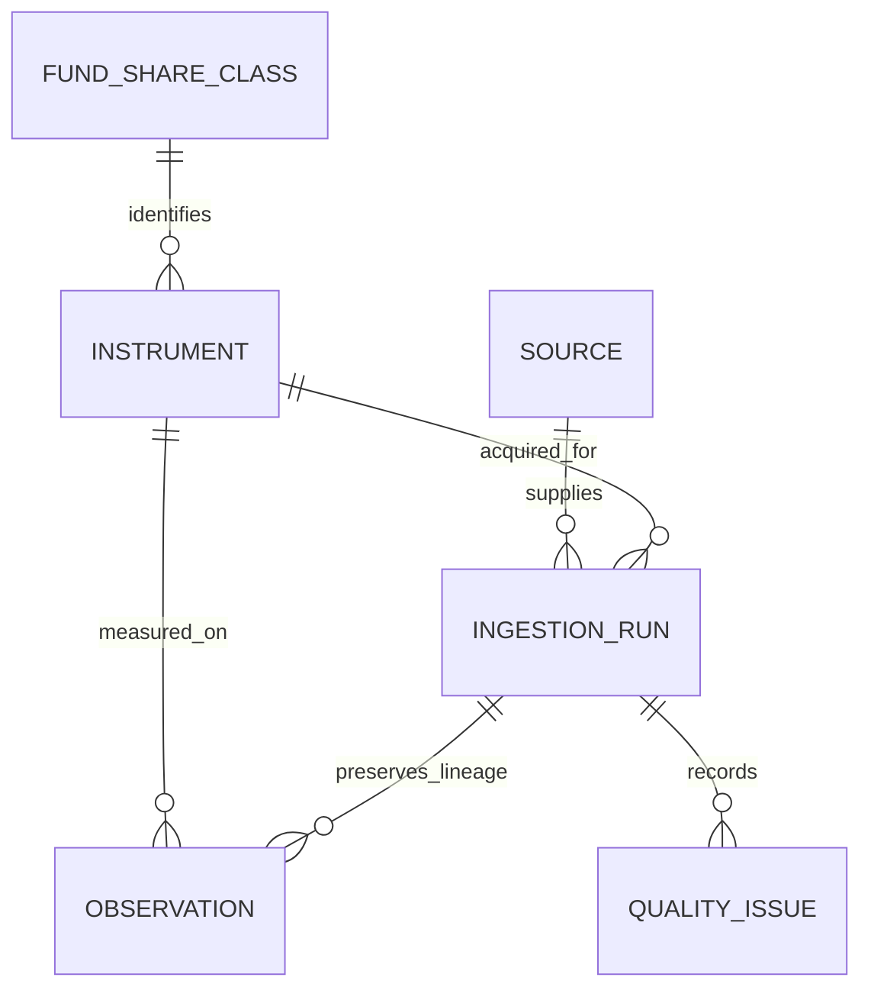

# Data dictionary

## Controlled risk views

analytics.nav_intervals now records policy_status approved_controlled_nav_v1; legacy proposed_interval_status labels remain. analytics.controlled_risk_summary has instrument/window grain: actual start/end dates, valid_count, status, annualized_volatility, zero-target downside_deviation, var_95, expected_shortfall_95 and tail_count; metric values are null below 252 eligible returns. analytics.controlled_rolling_volatility has instrument/date grain with interval_days, count_63/count_252 and nullable volatility_63/volatility_252. Counts use eligible inputs in original physical observation windows; full eligibility is required. Values are decimal fractions. Source observations remain unchanged. Cash/benchmark-relative metrics remain disabled because their source alignment/integration is incomplete. See [Power BI model](powerbi_data_model.md) for the twelve presentation-view grains and [reproduction](reproduction_guide.md) for SQL dependency order.

## Benchmark-stage extension

Authoritative extension: [benchmark_schema.sql](../sql/benchmark_schema.sql). The two NAV series remain unchanged. Original source IDs, acquisition timestamps, workbook checksums and raw worksheet rows are preserved in separate index ingestion runs. See [benchmark source definitions](benchmark_sources.md).

| Entity | Grain / fields / constraints |
| --- | --- |
| core.benchmark | One benchmark identity; generated benchmark_id PK, unique benchmark_code and instrument_id FK, benchmark_name, nullable provider_identifier, identifier_notes, benchmark_kind (official_index or etf_proxy), return_basis, metadata_url, date_alignment_status, limitations. Internal codes are not vendor identifiers. |
| core.benchmark_assignment | One fund/benchmark effective interval; benchmark_assignment_id PK, fund_instrument_id and benchmark_id FKs, inclusive effective_start_date/effective_end_date, rationale. Unique fund/start and GiST exclusion prevent overlapping assignments for a fund. Project-window assignments do not prove historical prospectus assignments. |
| analytics.nav_intervals | One actual NAV observation per approved fund; previous boundary date/value, elapsed interval_days, observed_interval_return, proposed eligibility and policy_status. First row has no preceding return. The interval view contains no annualized risk metric itself; policy_status is approved_controlled_nav_v1 and the controlled summary/rolling views consume eligible intervals. |

The benchmark extension uses PostgreSQL btree_gist for interval exclusion and grants the project loader SELECT/INSERT and sequence access. Benchmark corrections must use an explicit audit policy; repeated identical values are unchanged and conflicting values abort loading. Benchmark metadata and project-window assignments are implemented. Cash/FX and observation revisions remain deferred.

## Phase 4 analytical views

Views in `analytics` read validated native EUR NAV observations for the two approved instruments; they do not modify core values.

| View | Grain and important fields |
| --- | --- |
| daily_nav | Instrument/date; ISIN, NAV, currency, basis, quality status, source run ID, previous observed date/NAV. No claim that intervals are unrestricted daily-risk inputs. |
| calendar_gaps | Distinct instrument/date/classification across run-specific quality issues; deduplicates repeated attempt annotations. |
| period_returns | Instrument/period type/period start; actual prior boundary and end dates/NAVs, observation count, requested calendar period end, status, observed_return and nullable period_return. |
| monthly_returns / calendar_year_returns | Filtered monthly/year grains from period_returns. Decimal returns; incomplete full periods are null. |
| cumulative_return | Instrument/date; change relative to its first available NAV, with actual start date. |
| common_window | One row containing first/last dates shared by all approved NAV instruments. |
| drawdown_series | Instrument/date in common window; running observed peak, nonpositive drawdown, window bounds and original run lineage. |
| maximum_drawdown | Instrument/common window; observed max loss, peak/trough/first recovery dates, recovered/ongoing/not_applicable status, recovery or ongoing calendar days. |
| common_window_comparison | Instrument/common window; observations, cumulative NAV change, CAGR, drawdown fields and basis/calendar warning. Descriptive equity/bond comparison, not peer ranking. |

Return units are fractions (0.10 = 10%); durations are calendar days. Period status values: partial_period, stale_boundary, flagged_path (SQL guard), unresolved_gap, calendar_review, observed_boundaries. Flags are not automatically cleared. JSON outputs use null for unavailable values. Methodology and limitations are in [metric definitions](metric_definitions.md).

Current dictionary, documentation updated 16 October 2026. Core identities, source/run lineage, fund observations and flagged benchmark candidates are populated. Authoritative DDL: [schema.sql](../sql/schema.sql) and [benchmark extension](../sql/benchmark_schema.sql). Sources: [source register](source_register.md).

## Grain and relationships

`staging` reserves space for parsed/rejected records; `core` stores identities, acquisition lineage, observations and benchmark metadata; `analytics` contains implemented performance, controlled-risk and Power BI views. schema.sql defines six initial core tables, benchmark_schema.sql adds two core tables, and analytics views are separate DDL.

Each acquisition run concerns exactly one source, one instrument and one file. Repeating a download creates a new audit attempt; it does not create duplicate observations. An instrument defines a single immutable currency, value basis and adjustment interpretation. Switching from NAV to market close requires another instrument. Index instruments have no share-class parent.

All identity IDs are database-generated `bigint` primary keys. Calendar dates use `date`; event timestamps use `timestamptz`, displayed in UTC for logs. Country/currency/MIC formats are checked structurally, not against complete reference lists. ISIN checksum verification belongs in later Python validation. Nullable values mean unknown/not applicable, never zero.

## `core.fund_share_class`

Grain: one legal share class, identified by a unique ISIN.

| Column | PostgreSQL type / nullable | Meaning |
| --- | --- | --- |
| fund_share_class_id | bigint / no | Generated primary key |
| isin | varchar(12) / no | Unique uppercase ISIN; format checked |
| fund_name | text / no | Official fund name |
| share_class_name | text / no | Class label, e.g. 1C; preserve separately from name |
| issuer_name | text / no | Provider/issuer name, using a documented naming convention |
| legal_umbrella | text / yes | Legal issuing umbrella, separate from provider brand |
| domicile_country_code | varchar(2) / no | Legal fund domicile, ISO alpha-2, e.g. LU; never trading venue |
| asset_class | text / no | equity, bond, cash_like, mixed, other |
| category | text / no | Specific comparison category, e.g. eurozone sovereign investment grade |
| income_policy | text / no | accumulating or distributing |
| share_class_currency | varchar(3) / no | Class currency, e.g. EUR; not necessarily base, listing or exposure currency |
| hedging_policy | text / no | unhedged, hedged, unknown |
| hedge_currency | varchar(3) / yes | Required only for a hedged class |
| inception_date | date / yes | Share-class inception, not umbrella inception |
| ucits_status | boolean / no | Verified UCITS status; initial project entries must be true |
| benchmark_name | text / yes | Current descriptive benchmark only; not a historical assignment |
| metadata_source_url | text / no | Issuer evidence URL |
| metadata_as_of_date | date / no | Date to which metadata applies; document retrieval separately if different |
| created_at | timestamptz / no | Database row creation |

This table stores latest descriptive metadata, not historical truth. Charges snapshots and metadata history remain deferred. Effective project comparison assignments are implemented separately in core.benchmark_assignment.

## `core.instrument`

Grain: one uniquely defined observable series. Loaded NAV series codes are `LU0380865021:NAV:EUR:NATIVE` and `LU0290355717:NAV:EUR:NATIVE`. Index candidates have separate instruments without share-class parents.

| Column | Type / nullable | Meaning |
| --- | --- | --- |
| instrument_id | bigint / no | Generated primary key |
| instrument_code | text / no | Unique stable internal series key |
| fund_share_class_id | bigint / yes | Share-class FK, required for fund NAV/listings and absent for index |
| instrument_name | text / no | Human-readable series name |
| instrument_type | text / no | fund_nav, etf_listing, index |
| value_basis | text / no | nav, market_close, adjusted_close, total_return_index; type/basis compatibility checked |
| currency | varchar(3) / no | Units of the values in this series |
| adjustment_status | text / no | native, provider_adjusted, total_return, unknown; evidence must justify label |
| adjustment_notes | text / yes | Corporate-action/reinvestment semantics and remaining uncertainty |
| ticker | text / yes | Required for listing; null for NAV/index in this initial design |
| exchange_mic | varchar(4) / yes | Listing venue MIC, required with listing ticker |
| created_at | timestamptz / no | Row creation |

Partial unique indexes prevent duplicate NAV identities and identical listings with the same basis. Do not overwrite currency/basis to reinterpret existing values. Multiple providers for one instrument feed the same canonical observations; conflicting values require explicit reconciliation.

## `core.source`

Grain: one provider/dataset access definition, potentially an instrument-specific export such as register S01 or S06.

| Column | Type / nullable | Meaning |
| --- | --- | --- |
| source_id | bigint / no | Generated primary key |
| source_code | text / no | Unique register identifier |
| provider_name, source_name | text / no | Provider and dataset label |
| source_url | text / no | Canonical product/dataset URL; exact request belongs in run |
| access_method | text / no | http_xlsx, http_csv, http_json, manual_download |
| authentication_required | boolean / yes | True/false when tested, null if unknown |
| terms_url | text / yes | Applicable provider terms |
| terms_reviewed_on | date / yes | Terms review date |
| local_use_status, redistribution_status | text / no | Independently permitted, restricted or unresolved; default unresolved |
| permission_notes | text / yes | Evidence and interpretation; access success is not a permission grant |
| created_at | timestamptz / no | Row creation |

## `core.ingestion_run`

Grain: one attempt to acquire/parse/load one file for one instrument. Same checksum may occur in multiple attempts, so it is indexed rather than unique.

| Column | Type / nullable | Meaning |
| --- | --- | --- |
| ingestion_run_id | bigint / no | Generated primary key |
| source_id, instrument_id | bigint / no | Source and instrument FKs |
| started_at | timestamptz / no | Attempt start |
| completed_at | timestamptz / yes | Required for terminal succeeded/failed status; not before start |
| retrieved_at | timestamptz / yes | File acquisition completion; importing cached files retains their actual acquisition date |
| status | text / no | started, succeeded, failed |
| request_url | text / yes | Exact HTTP request without secrets; null allowed for manual/cached import |
| request_parameters | jsonb / no | JSON object of nonsecret parameters; default empty object |
| requested_start_date, requested_end_date | date / yes | Both present or both absent; ordered |
| observed_start_date, observed_end_date | date / yes | Actual bounds; both present or absent for no valid dated rows |
| raw_file_path | text / yes | Repository-relative original-file path; no embedded credentials |
| file_sha256 | varchar(64) / yes | Lowercase hexadecimal raw-byte checksum |
| file_bytes | bigint / yes | Nonnegative raw-file size |
| rows_read | integer / yes | Candidate data rows after excluding workbook metadata |
| rows_accepted, rows_rejected | integer / yes | Validation partition; accepted + rejected = read when all known |
| rows_inserted | integer / yes | Newly inserted observations; at most accepted; identical repeats insert zero |
| pipeline_version | text / yes | Git revision or explicit version, required for success |
| error_message | text / yes | Sanitized failure detail |

Succeeded runs retain file/timestamp/checksum/count/version provenance. The current atomic loader raises conflicts and rolls back the batch; it does not persist a separate failed-run audit entry. Do not claim every rejected attempt has a retained database run. Separate failed-attempt auditing is deferred. The DDL does not enforce a complete ingestion state machine; loader assertions/tests supplement structural checks.

## `core.observation`

Grain and primary key: `(instrument_id, observation_date)`; one current accepted value per series/day.

| Column | Type / nullable | Meaning |
| --- | --- | --- |
| instrument_id | bigint / no | Instrument FK; supplies currency and basis |
| observation_date | date / no | Valuation date, not download date |
| value | numeric(20,10) / no | Positive finite NAV/price/index level; ten fractional digits; rejected rows stay outside this table |
| ingestion_run_id | bigint / no | Run FK; composite FK also ensures that run belongs to this instrument |
| raw_row_number | integer / yes | Positive one-based worksheet row number; spreadsheet origin |
| quality_status | text / no | valid or flagged; flagged values need review before analytics |
| created_at | timestamptz / no | Initial insert time |

Initial DWS mapping: workbook identity block verifies ISIN and EUR; `Date` maps to observation_date and `NAV` maps to value. Discover the header by names rather than assuming a fixed row. Ignore blank rows and disclaimer text. Asset Under Management and Interim Profits remain auxiliary raw fields. Index Level is loaded separately as a flagged benchmark candidate, never substituted for NAV. Parse dates explicitly as DD.MM.YYYY and sort after validation. N/A is missing, never zero.

Unchanged duplicate values are no-ops. Conflicting stored observations raise ObservationConflict and roll back the batch without overwriting observations; they are not guaranteed a persisted error-issue record. Full revision history is deferred; a future correction process must add an auditable revision policy before changing canonical values.

## `core.quality_issue`

Grain: one check finding for a run/instrument, optionally a source row/date. No observation FK: rejected rows may never become observations.

| Column | Type / nullable | Meaning |
| --- | --- | --- |
| quality_issue_id | bigint / no | Generated primary key |
| ingestion_run_id, instrument_id | bigint / no | Composite FK enforces run/instrument match |
| observation_date | date / yes | Affected date if parseable; null for file-level/invalid-date issue |
| raw_row_number | integer / yes | Affected positive worksheet row |
| check_code | text / no | Stable check identifier, e.g. invalid_date, invalid_value, conflicting_duplicate, identity_mismatch, unexpected_gap |
| severity | text / no | info, warning, error |
| details | text / no | Evidence and reason without credentials |
| issue_status | text / no | open, resolved, accepted; accepted means explicitly acknowledged, not fixed |
| resolution_notes | text / yes | Required for resolved/accepted |
| resolved_at | timestamptz / yes | Required for resolved/accepted; at/after creation |
| created_at | timestamptz / no | Finding timestamp |

## Indexes, validation and deferred entities

Primary/unique constraints create their own indexes. Additional indexes cover share-class relationships, source/run lookups, instrument/run time, checksums, cross-instrument observation dates, run lineage, and open quality issues. The observation PK supports instrument/date ranges without another redundant index.

Database checks guard structure, positive finite values and provenance relationships. Python validates source identity, parsing, numeric precision/positivity, duplicate conflicts and documented coverage. ISO reference-list/ISIN check-digit certification, full historical calendar resolution and corporate-action adjustment certification must not be inferred from format checks. No daily price filling or missing-to-zero substitution is allowed.

FX, cash integration, distributions, time-varying metadata and observation revisions remain deferred. Benchmark metadata/assignments and performance/controlled-risk/Power BI views are implemented. Benchmark date/basis alignment is unverified, so correlation, beta, tracking error, information ratio and benchmark-relative claims remain disabled; Sharpe/Sortino require integrated matching cash history. Native NAV/observed-path/calendar caveats remain in force. DWS source publication permission is unresolved and redistribution restricted; a populated table does not establish publication rights.
