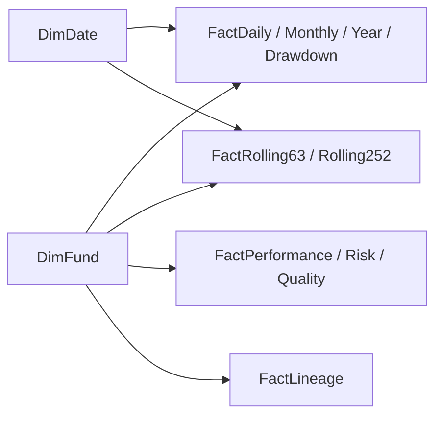

# Power BI data model

Presentation version pbi-v1 uses validated PostgreSQL calculations unchanged. Import mode is preferred for the small local model. Only the two native EUR NAV instruments enter these views; flagged benchmark index series are excluded. Benchmark names are descriptive metadata only. See [Microsoft star-schema guidance](https://learn.microsoft.com/en-us/power-bi/guidance/star-schema).

## View grains and keys

All views are in analytics. Keys below are verified logically; PostgreSQL views have no physical primary-key constraints. SQL: [powerbi_views.sql](../sql/powerbi_views.sql).

| PostgreSQL view | Power BI name | Exact grain / logical unique key |
| --- | --- | --- |
| pbi_fund_overview | DimFund | One NAV instrument; instrument_id |
| pbi_date | DimDate | One calendar date, full years covering NAV history; date_key |
| pbi_daily_performance | FactDaily | One instrument/observed date; instrument_id + date_key |
| pbi_monthly_returns | FactMonthly | One instrument/month; instrument_id + date_key (month start) |
| pbi_calendar_year_returns | FactYear | One instrument/year; instrument_id + date_key (year start) |
| pbi_drawdowns | FactDrawdown | One instrument/observed date in common performance window; instrument_id + date_key |
| pbi_performance_snapshot | FactPerformance | One instrument/predefined window/as-of; instrument_id + window_key + date_key |
| pbi_risk_snapshot | FactRisk | One instrument/predefined controlled-risk window/as-of; instrument_id + window_key + date_key |
| pbi_rolling_63 | FactRolling63 | One instrument/observed date; instrument_id + date_key |
| pbi_rolling_252 | FactRolling252 | One instrument/observed date; instrument_id + date_key |
| pbi_quality_summary | FactQuality | One instrument/current coverage-as-of; instrument_id + date_key |
| pbi_source_lineage | FactLineage | One instrument/original contributing run; instrument_id + ingestion_run_id |

## Relationships

DimFund[instrument_id] 1:* to instrument_id on every fact. Single direction from dimension to fact. DimDate[date_key] 1:* to date_key on FactDaily, FactMonthly, FactYear, FactDrawdown, FactRolling63 and FactRolling252. Single direction, active. Mark DimDate as the date table. Do not connect facts to each other, ISIN to instrument_id, or original run IDs between facts. No bidirectional or many-to-many links.

**Snapshots and quality are fixed-window facts:** connect only DimFund, not DimDate. This prevents an arbitrary chart-date filter from implying that a fixed snapshot was recomputed. FactLineage has only its DimFund relationship; source_id/run_id are lineage fields, not additional joins. Peak/trough/recovery, start/end and retrieval dates are attributes, not extra active relationships. DimFund instrument_id is unique even if a later share class has multiple measurable instruments.

## Window/filter contract

Performance snapshot: common full-history 2021-09-30–2026-09-30. Controlled-risk snapshots use the chosen 2023-12-01 to 2026-09-30 window. Show these dates beside each respective card group; they are different analytical windows. The arbitrary **Chart date window** slicer changes chart visibility only; snapshot cards retain their explicit fixed windows. Do not label a filtered subset of an all-history rebased or drawdown chart as a freshly rebased selected-window analysis. Rebased NAV starts at 100 on the stored base_date; drawdown preserves the common-window running peak.

Executive/Detail: single-select fund required for cards. Comparison page can select both funds but does not sum/average returns or rank across asset classes. Blank incomplete periods remain blank. If later arbitrary-window KPIs are needed, first implement/reconcile additional SQL snapshots with distinct window keys; do not approximate them with DAX.

## Refresh and restrictions

All declared keys are non-null/unique; every fund/date FK matches its dimension; snapshot values match underlying validated views exactly. Incomplete-period returns remain NULL; detailed observed counts are local. Local exports and validation evidence are in data/processed/powerbi/. The user reports all five pages completed and manually reviewed. No independent PBIX relationship/visual/refresh inspection is claimed; see [dashboard evidence](../reports/powerbi_validation.md).

dataset_query_timestamp in FactQuality is the PostgreSQL read/Import evaluation timestamp, not a NAV acquisition time or proof Desktop refresh succeeded. Use separate one-row Power Query RefreshInfo for actual model refresh UTC. latest NAV date is data-as-of; retrieved_at is original source acquisition. Display all three concepts separately. Core NAVs retain original run lineage. Suppressed metrics are listed as unavailable, never zero. No benchmark-relative figures or ML fields are included. Financial columns must default to **Don't summarize**; explicit single-fund measures enforce context.
